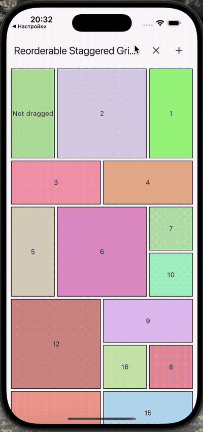
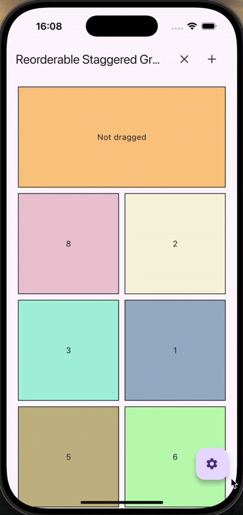

# reorderable_staggered_grid_view

<!-- [](https://pub.dartlang.org/packages/reorderable_staggered_scroll_view) [](https://github.com/itisnajim/reorderable_staggered_scroll_view/blob/master/LICENSE)  [](https://github.com/itisnajim/reorderable_staggered_scroll_view/issues) -->

A Flutter package for creating reorderable and draggable staggered grid views. This package provides an intuitive way to build a grid with the ability to change the order, and also supports lazy element building, which allows it to be used for a large number of complex elements without loss of performance. 

| Reordering | Not dragged |
| :---: | :---: | 
| |  |

## Features

* Reorder items with ease using drag and drop gestures
* Lazy construction of grid elements
* Configurable drag-and-drop behavior
* The APIs provided by the library provide great opportunities for customization and customization of the appearance and interactive features of the grid (animations, feedback widget, etc.)

| Adding/deleting | Actions |
| :---: | :---: | 
|  |  |

## Getting Started

To use this package, add it to your pubspec.yaml file:

```yaml
dependencies:
  reorderable_staggered_grid_view: ^latest_version
```
Replace ^latest_version with the actual version you want to use.

Import the package in your Dart code:

```dart
import 'package:reorderable_staggered_grid_view/reorderable_staggered_grid_view.dart';
```

## Usage

The package provides two classes: ```ReorderableStaggeredGridView``` and ```ReorderableStaggeredGridItem```. Both have many parameters for customizing scrolling, animations, sizes, and so on.

### Create items

Create a ```List<ReorderableStaggeredGridItem>``` and store it in the state of your widget. Items must be reused between builds: each item has a ```GlobalKey``` that is used for animations and dragging.

```dart
late final List<ReorderableStaggeredGridItem<int>> _items = List.generate(
  10,
  _generateItem,
);

ReorderableStaggeredGridItem<int> _generateItem(int index) {
  return ReorderableStaggeredGridItem(
    data: index,
    // The first item can't be dragged
    isDraggable: index != 0,
    mainAxisCellCount: Random().nextInt(2) + 1,
    crossAxisCellCount: Random().nextInt(2) + 1,
    child: TileWidget(
      // A global key preserves the internal state of the child while dragging
      key: GlobalKey(),
      title: Text(index == 0 ? 'Not dragged' : index.toString()),
    ),
  );
}
```

### Build grid

Use the ```ReorderableStaggeredGridView.builder()``` constructor, which builds the elements lazily. The grid doesn't change the order of your items by itself: move the dropped item in ```onAcceptWithDetails``` and rebuild the widget. Other items smoothly animate to their new positions.

```dart
return ReorderableStaggeredGridView.builder(
  padding: const EdgeInsets.all(10),
  enable: enableDragging,
  crossAxisCount: 4,
  mainAxisSpacing: 10,
  crossAxisSpacing: 10,
  isLongPressDraggable: enableLongPress,

  // Items
  itemCount: _items.length,
  itemBuilder: (context, index) => _items[index],

  // Reordering
  onAcceptWithDetails: (details, newIndex) {
    final item = _items.firstWhere((e) => e.data == details.data);
    setState(() {
      _items.remove(item);
      _items.insert(newIndex, item);
    });
  },
);
```

### Saving states

To preserve the internal state of the elements, assign a ```GlobalKey``` to the child widgets. Then the elements don't lose their internal state when they are dragged or when the grid layout changes.

Check the example to see all the subtleties of the package implementation that was originally conceived.

## Future

The following functions are planned to be implemented:

* Shifting grid items without releasing the dragged widget
* Creating grid constructors for lazy and non-lazy buildings of elements

## Contributing

We welcome contributions! If you have ideas for improvements or encounter issues, please open an issue or submit a pull request.

## Author

lgusev, rastrast207@gmail.com

## License
This package is licensed under the MIT License. See the LICENSE file for more details.